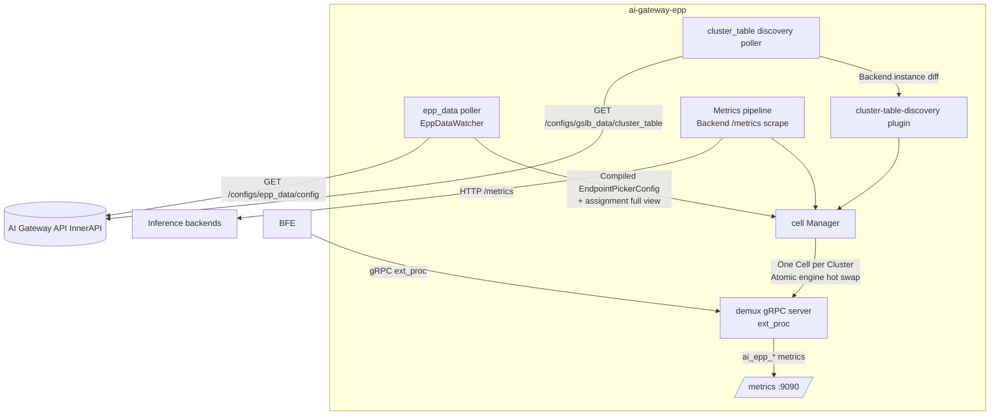

# Chapter 36 EPP Component Implementation

## Chapter Goals

EPP intelligent scheduling spans three code repositories: the Control Plane ai-gateway-api, the Data Plane BFE, and the scheduler ai-gateway-epp. This chapter explains the code organization and key paths of all three sides from an implementation perspective:

- The process structure of ai-gateway-epp: command-line parameters, the dual-poller + Cell engine architecture, and the interaction with the AI Gateway API InnerAPI;
- The Control Plane implementation of ai-gateway-api: the model layer of the instance pool and assignments, the compiler, parameter validation and mapping for `epp_config` / `epp_runtime`, the OpenAPI and InnerAPI endpoint layers, Cluster integration, and configuration export;
- The Data Plane implementation of BFE: parsing of the `GslbBasic` EPP fields, the ext_proc gRPC client, EPPCheck hysteresis switching, runtime-parameter hot reload (runtime signature), failure fallback, and metrics instrumentation.

For design semantics and operations, see [Chapter 16 EPP Scheduling Design](../design/chapter16-epp-scheduling-design.md) and [Chapter 26 EPP Scheduling Configuration and Operations](../operation/chapter26-epp-scheduling-operation.md).

---

## Overview of the ai-gateway-epp Component

ai-gateway-epp is a multi-Cluster scheduler based on the llm-d EPP: it runs in a configuration-driven way (no dependency on Kubernetes CRDs), consumes the scheduling configuration and assignment view exported by the AI Gateway API InnerAPI, and provides backend selection decisions to BFE via the gRPC ext_proc protocol. The code lives in the `ai-gateway-epp/` repository.

### Command-Line Parameters

The entry point is `cmd/epp/main.go`; parameter parsing is in `parseConfig` of `cmd/epp/config.go`:

| Parameter | Default | Description |
|-----------|---------|-------------|
| `-api-addr` | `http://127.0.0.1:8181/inner-api/v1` | InnerAPI base address |
| `-api-token` | Environment variable `AI_GATEWAY_EPP_TOKEN` | InnerAPI authentication token |
| `-group-name` | Environment variable `AI_GATEWAY_EPP_GROUP_NAME` (some design documents also write it as epp-group / AI_GATEWAY_EPP_GROUP; the ai-gateway-epp implementation is authoritative) | Instance group identity, which must match a group name registered in `/epp-pool`; used to locate the Clusters borne by this group in the assignment full view (goes together with instance-group allocation granularity and is released in the same version as the Control Plane, the schema upgrade, and the front end) |
| `-poll-interval` / `-poll-timeout` | `5s` / `3s` | InnerAPI polling interval and per-request timeout |
| `-grpc-port` / `-health-port` / `-metrics-port` | `9002` / `9003` / `9090` | ext_proc, health check, and metrics server ports |
| `-grpc-tls-cert` / `-grpc-tls-key` | empty (plaintext) | Server-side TLS for ext_proc and health gRPC |
| `-bind-address` | empty (all interfaces) | Listen address |
| `-default-pool` | empty | Fallback Cluster when a request lacks the inference-pool metadata (empty = reject) |
| `-engine-drain-timeout` | `60s` | In-flight request drain cap for the old engine during an engine hot swap |
| `-refresh-metrics-interval` | `50ms` | Scrape interval for backend `/metrics` metrics |
| `-local-config-dir` | Environment variable `AI_GATEWAY_EPP_LOCAL_CONFIG_DIR`, empty by default | Local configuration directory: when non-empty, cluster-level configuration is loaded from local JSON via `LocalFileSource` and InnerAPI is not contacted (empty = use InnerAPI) |

For building, `make release` of the repository Makefile cross-compiles release tarballs for linux/amd64 and linux/arm64, and `make clean` cleans up build artifacts.

### Dual-Poller + Cell Engine Architecture

Two pollers run inside the process, both based on the `Source[T]` incremental polling framework in `pkg/poller/poller.go` (version negotiation, skip on `Data==null`, failure backoff, fail-static retention of locally known configuration):



The division of labor between the two pollers:

- **epp_data poller** (`EppDataWatcher` in `pkg/poller/epp_data.go`): a single pull obtains both configuration sections. It self-matches against the assignment full view by its own group identity (`-group-name`): if an entry's group equals this instance's group, the Cluster belongs to this group; a diff against the local Cell set then drives `Ensure` / `Drop` of `pkg/cell/manager.go` (with group granularity there is no Promote/Demote and no primary/standby roles). The `epp_config` section and the assignment section are processed within the same version snapshot, so the two are naturally consistent. When this instance's group has no entry at all in the assignment, the `ai_epp_assignment_no_match` metric is set, making it easy to spot a misconfigured group name during deployment.
- **cluster_table discovery poller** (`pkg/poller/discovery.go`): diffs the backend instance list exported by cluster_table into the endpoint set of each Cluster; instances with `Weight==0` are treated as drained and skipped directly, and instances that have disappeared from the export are removed accordingly.

The data source of both pollers can be switched to local files: when `-local-config-dir` (environment variable `AI_GATEWAY_EPP_LOCAL_CONFIG_DIR`) is non-empty, `cmd/epp/main.go` replaces the InnerAPI client with `LocalFileSource` from `pkg/poller/local_source.go`, reading `cluster_table.json` and `epp_data_config.json` from a local directory (the content is the `Data.Config` layer of the InnerAPI response, without the envelope and version fields) and never contacting InnerAPI. The fetch-consume flow, Cell lifecycle, and engine compile-swap path are fully reused; local files have no version semantics, so every polling cycle (5s by default) re-reads them in full, edits take effect in the next cycle, and a missing file or invalid JSON is handled as a polling failure (exponential backoff retry, keeping the last successful configuration). An `epp_pool.json` (instance pool definition) may also be placed in the directory for debugging reference only — EPP does not consume it. This mode targets local debugging and integration testing; production still relies on InnerAPI hot loading.

Cell engine hot swap happens in `pkg/cell/manager.go`: when epp_config changes, the engine is recompiled per Cluster (`pkg/cell/compile.go`; the llm-d loader loads the complete `EndpointPickerConfig`), the pointer is swapped atomically after hash comparison, and the old engine drains (default 60 seconds) before being destroyed; a compile failure of a single Cluster only affects that Cluster (the old engine keeps running) and does not spread to other Clusters.

demux (`pkg/demux/server.go`) is the ext_proc gRPC server: it extracts `llm-d.ai → inference-pool` (i.e. the Cluster name) from the `MetadataContext` of the first message and routes to the corresponding Cell; a Cell that is not serving yet (draining) returns `ErrCellDraining` (BFE classifies `cell is not serving` as a draining error accordingly and retries on the next address); the decision result is returned in `dynamic_metadata` of the response at `envoy.lb → x-gateway-destination-endpoint`. demux also handles request correlation: it reads `x-request-id` from the request headers of the first ext_proc message and, when missing, generates a UUID and writes it back into the headers — the llm-d engine logs and EPP's own logs share the same request ID, every per-request logger carries it, and the BFE → EPP → inference engine logs of all three parties can be stitched by request ID.

---

## Control Plane Implementation: ai-gateway-api

### model/epp_pool: Instance Pool, Assigner, and Compiler

The model-layer code is concentrated in `ai-gateway-api/model/epp_pool/`; the storage layer is in `ai-gateway-api/storage/rdb/epp_pool/` (DAO operations on the `epp_instances` and `epp_assignments` tables):

| File | Responsibility |
|------|----------------|
| `epp_pool.go` | Instance pool read/write: GET/PATCH semantics of `/epp-pool` (full replacement of `epp_instances`) and field validation (unique group names, unique ids, unique `(host,port)`, group size) |
| `epp_config.go` | Structure definition and field validation of the simplified `epp_config` form (enums, ranges, seconds values, session-affinity pairing rule) |
| `compiler.go` | Compiler: deterministically expands the simplified `epp_config` into a complete `EndpointPickerConfig` — fixed injection of `cluster-table-discovery` / scorers / `max-score-picker` / `openai-parser`, mapping base (kv, queue) weights by `load_profile` and affinity scorer weights by `affinity` (not injected when `off`), utilization-filter conditions always containing kv-cache-utilization (waiting-queue / running-requests appended when their thresholds are enabled), saturation-detector (utilization-detector type) always injected (KV threshold shares the same source as the filter, metric staleness threshold taken from the bad-backend eviction configuration), the `flowControl` section always emitted (including the saturationDetector reference and the priority 0 band) and `flowControl` appended to `featureGates` only when `flow_control` is configured; rules are fixed in a code template and covered by unit tests; `flowControl` always carries an explicit priority 0 band (all EPP requests run in band 0, preventing the llm-d hidden band defaults of 5000 concurrency / 1GB memory from silently truncating the global `max_requests`; when `max_requests` is unset / `-1`, band 0 is explicitly set to 10000 concurrency and 5Gi memory) |
| `assignment.go` | Assigner: greedy + deterministic tie-break group selection algorithm (the group with the smallest assignment load wins; ties break by lexicographically smallest group name), upserting into `epp_assignments` (storing only the cluster→group mapping) |
| `reconciler.go` | Periodic reconciliation (30 seconds, configurable): scans all `balance_mode=EPP` Clusters and automatically repairs those without a valid assignment or with a dangling assignment (cross-group reassignment → assignment clearing when no candidate group remains), idempotent with zero writes in most rounds |
| `epp_data.go` | epp_data generator: merges both sections at export time — the epp_config section (compiled per Cluster) + the assignment section (the cluster→group full mapping joined at read time from `epp_assignments`; unassigned/dangling Clusters produce no entry) — going through the `VersionControlManager.ExportConfig` framework (topic `ConfigTopicEppData`, MD5 signature + version increment) |

### Endpoint Layer

| Directory | Endpoints | Implementation |
|-----------|-----------|----------------|
| `endpoints/openapi_v1/epp_pool/` | `GET` / `PATCH /open-api/v1/epp-pool` | `get.go`, `patch.go`; singleton resource, pool name from the configuration item `RunTime.DefaultEPPInstancePoolName` (default `EPP.pool`); PATCH validates then fully replaces and triggers automatic repair of dangling assignments |
| `endpoints/openapi_v1/epp_assignments/` | `GET /open-api/v1/epp-assignments`, `PUT /open-api/v1/epp-assignments/{cluster}` | `get.go`, `put.go`; GET returns the full view (each per-cluster element carries only `{cluster, group}`, plus the aggregate `unassigned_clusters` and `idle_groups`); PUT manually overrides with `{"group_name"}` (validating that the group exists in the instance pool) and bumps the server_data_conf version |
| `endpoints/innerapi_v1/epp_data/` | `GET /inner-api/v1/configs/epp_data/config` | `export.go`; authentication reuses `FeatureRoute + ActionExport`, `version` increment (returns `Data: null` when unchanged) |
| `endpoints/openapi_v1/product_cluster/` | `POST/PUT /open-api/v1/clusters` | `create.go`, `update_basic.go`; the request body parses `balance_mode`, `epp_config` and `epp_runtime` and enforces conditional requiredness and field validation |

### Cluster Integration and Configuration Export

- `model/icluster_conf/cluster.go`: the creation path generates a `Role=EPP` type instance pool according to `balance_mode`, and still fills the pool with the Provider `instance_pool` instances as usual (for the cluster_table export and BFE fallback WRR); `getBalanceMode()` reads the `balance_mode` field directly and is the sole source of truth for EPP mode; `ProviderInstancePoolSyncer` syncs to all Clusters referencing that Provider (including EPP pools) when a Provider instance pool changes (e.g. an instance `weight=0`).
- `model/icluster_conf/epp_runtime.go`: parsing and validation of `epp_runtime` — strict field parsing (an undefined field such as `tls` / `breaker` yields 422), durations must be positive, and missing subfields are filled with defaults before being persisted on write; the rules line up one by one with BFE's `EPPCheckConfCheck` / `EPPTimeoutConfCheck`.
- `model/icluster_conf/exporter.go`: cluster_table export; EPP pool instances enter the export list as usual (`Weight=0` means drained).
- `model/iroute_conf/exporter.go` (together with `model/icluster_conf/cluster.go` and `model/icluster_conf/epp.go`): server_data_conf export. When an EPP-mode Cluster has a valid assignment, it exports `GslbBasic.BalanceMode=EPP` and `EPPAddr` (a single element: the address of the instance inside the assigned group; the group is located via `epp_assignments` and the instance address is joined via `net.JoinHostPort`), and by design always exports `EPPTLS{Plaintext:true}` and `EPPBreaker{Disabled:true}`; when `epp_runtime` has been persisted, its check / timeout are mapped to `EPPCheck` / `EPPTimeout`, otherwise nothing is distributed and BFE applies the same defaults at load time. When there is no valid assignment, the Cluster degrades to `BalanceMode=WRR` with no `EPPAddr` generated, and an error-level log (including the Cluster name and reason) is output without blocking the whole distribution.

---

## Data Plane Implementation: BFE

The BFE-side implementation is concentrated in three places: configuration parsing, load balancing, and the reverse proxy.

### Configuration Parsing and Validation

`bfe/bfe_config/bfe_cluster_conf/cluster_conf/cluster_conf_load.go`:

- `BalanceModeEPP = "EPP"` enum (`:66`); `GslbBasicConf` carries `EPPAddr *[]string` (currently always a single element; the type is kept for future multi-address expansion) and four optional structs `EPPCheck` / `EPPTimeout` / `EPPTLS` / `EPPBreaker` (`:481-485`), all with defaults; `EPPCheck` / `EPPTimeout` come from the Control Plane per Cluster via `epp_runtime` — when unconfigured they are not distributed and defaults are filled at load time;
- EPP-mode validation (`GslbBasicConfCheck`, from `:808`): when `BalanceMode=EPP`, `EPPAddr` is non-empty (`:838`); `checkEPPAddrs` validates that elements are `host:port` and deduplicates within the list (`:880`); `EPPCheckConfCheck` / `EPPTimeoutConfCheck` / `EPPBreakerConfCheck` / `EPPTLSConfCheck` fill defaults and validate. An unconfigured `EPPTLS` is auto-filled with `{Plaintext: true}` (plaintext dial, no TLS) plus a warning log advising explicit `{Insecure:true}` or `{CAFile:...}` when TLS is wanted (`:938-940`); `EPPTLSConfCheck` (from `:1097`) enforces a mutually exclusive three-way choice: `Plaintext` (plaintext dial) is mutually exclusive with `Insecure` / `CAFile`, and when not Plaintext and `Insecure=false`, `CAFile` must be readable;
- On the dialing side, `epp.NewGrpcConn` (`bfe/bfe_util/epp/epp_client.go`) uses `insecure.NewCredentials()` plaintext credentials when `plaintext` is set, and otherwise builds TLS config from `insecureSkip` / `caFile`;
- Validation failures fail fast: the reload reports an error and is rejected, keeping the old configuration effective — no silent degradation.

Operational constraint: during a rolling upgrade, upgrade the BFE binaries in full before distributing a cluster_conf configuration containing `Plaintext`. Older BFE versions do not recognize the `Plaintext` field; such a configuration is parsed as "TLS without CAFile" and rejected on load (fail-fast), breaking the hot reload.

### ext_proc Calls and Scheduling Integration

- `bfe/bfe_util/epp/epp_client.go`: the ext_proc gRPC client. A long-lived connection is maintained per EPP address (streams are established per request); the first `ProcessingRequest` has its request headers built by `BuildEnvoyGRPCHeaders`, injecting `MetadataContext.FilterMetadata["llm-d.ai"] = {"inference-pool": <cluster name>}`; the response path relays the body back in streaming via `EppResponseBodyFilter`, using a bounded buffer — on overflow the whole stream is abandoned with counting and instrumentation, guaranteeing that EndOfStream is always delivered.
- `bfe/bfe_balance/bal_gslb/bal_gslb.go`: `BalanceGslb` holds the `eppAddrs` address table and the active index. `SetGslbBasic` (`:92`) dispatches by `BalanceMode` and records the `EPPTLS.Plaintext` plaintext dialing mode; `initEPP` (`:205`) / `closeEPP` manage connections and a background health-check goroutine per address (gRPC health, parameters from `EPPCheck`). `initEPP` uses `runtimeSignature()` (`epp_runtime.go:66`; the signature covers `EPPTLS`, `EPPTimeout.Connect`, `EPPCheck.Disabled` and the address table) to decide between an in-place update and a runtime rebuild: changes to connection-shaped, lifecycle-shaped or topology parameters trigger a rebuild, while changes to read-once parameters (`EPPTimeout.Call`, `EPPCheck` hysteresis) are applied in place via `updateConf` without interrupting in-flight requests; the old runtime retires gracefully through `retireEPPLocked` (`:252`) (probes stop first, connections close after a grace period), and when the address table is unchanged the new runtime inherits the active / health state via `inheritStateFrom`; when the breaker configuration is unchanged `updateConf` returns early, so a reload no longer wipes the breaker sliding window. `chooseBackendFromEPP` (`:296`) builds and sends the first ext_proc message and waits for the decision; `BalanceEpp` (`:708`) maps the EPP-decided address to a local backend and constructs a temporary backend.
- `bfe/bfe_server/reverseproxy.go` (`:345-355`): request-side integration. EPP mode calls `BalanceEpp`; on failure it falls back to the local `Balance()` (WRR); retries reuse the same connection to establish a new stream.
- Hysteresis state machine: the active address fails over to the next address after failing consecutively `FailThreshold` times, then enters a `Cooldown` period with no switch-back; after the cooldown, a higher-priority address must pass the health check consecutively `SuccessThreshold` times before failback. For `Unavailable / cell is not serving` and `unknown inference pool` errors, the request is retried directly on the next address of the same Cluster without waiting for the health check cycle.

The sequence of a single EPP call is as follows:

```mermaid
sequenceDiagram
    participant BFE
    participant EPP as ai-gateway-epp (instance group)
    participant RS as Inference backend

    BFE->>EPP: ProcessingRequest (RequestHeaders)
    Note over BFE: Metadata injects llm-d.ai: inference-pool=<cluster name>
    BFE->>EPP: ProcessingRequest (RequestBody)
    EPP->>EPP: Filter (utilization-filter) + weighted scoring + max-score-picker
    EPP-->>BFE: Decided endpoint address (envoy.lb → x-gateway-destination-endpoint)
    Note over EPP: read or generate x-request-id and write it back; logs of all parties correlate by ID
    BFE->>RS: Forward via a temporary backend built from the decided address
    RS-->>BFE: Response
    BFE->>EPP: ResponseHeaders + streaming body relay
    BFE-->>BFE: epp_calls_total{result="ok"} +1
```

### Metrics Instrumentation

`bfe/bfe_balance/bal_gslb/epp_metrics.go` implements labeled metrics with Prometheus CounterVec/GaugeVec, exposed in text format via `/monitor/epp_metrics` registered in `bfe/bfe_server/web_server.go`:

- `epp_calls_total{cluster,result}`: result ∈ `ok` / `no_pool` / `unknown_pool` / `draining` / `transport`;
- `epp_fallback_local_total{cluster}`: number of local WRR fallbacks;
- `epp_failover_total{cluster}` / `epp_failback_total{cluster}` / `epp_active_addr_index{cluster}`.

---

## EPP-Side Implementation: ai-gateway-epp

| Location | Responsibility |
|----------|----------------|
| `pkg/poller/poller.go` | `Source[T]` polling framework: version increment, failure backoff, fail-static; metrics `ai_epp_poller_last_sync_timestamp` / `ai_epp_poller_failures_total` / `ai_epp_poller_backoff_state` |
| `pkg/poller/epp_data.go` | `EppDataWatcher`: consumes both sections of `/configs/epp_data/config`; self-matches assignment entries by its own group identity (`-group-name`); assignment diff drives `Manager.Ensure/Drop`; `ai_epp_assignment_no_match` metric |
| `pkg/poller/discovery.go` | cluster_table polling and backend instance diff; `Weight==0` skipped (drained), disappeared instances removed |
| `pkg/innerapi/client.go` | InnerAPI HTTP client: `{ErrNum, ErrMsg, Data, WorkMode}` envelope, `?version=` increment, `Data==null` semantics; `EppDataConfigPath = "/configs/epp_data/config"` |
| `pkg/cell/manager.go` | Cell lifecycle and atomic engine hot swap (hash comparison → compile → pointer swap → old engine drain and destroy); `ai_epp_engine_reloads_total` / `ai_epp_cell_state` |
| `pkg/cell/compile.go` | Loads the compiled `EndpointPickerConfig` with the llm-d loader; a single Cluster compile failure keeps the old engine (defensive fallback) |
| `pkg/demux/server.go` | ext_proc gRPC server: `extractPool` extracts the inference-pool from metadata to route to a Cell; a Cell that is not serving yet (draining) returns `ErrCellDraining`; the decided address is written to `envoy.lb → x-gateway-destination-endpoint`; reads or generates `x-request-id` from the first message's request headers and writes it back, using it as the correlation key across the engine and EPP logs |
| `cmd/epp/plugins.go` | Plugin registration: `prefix-cache-scorer`, `session-affinity-scorer`, the `flowcontrol` plugin family, the `approx-prefix-cache` producer, `cluster-table-discovery`; the `flowControl` feature gate is off by default and enabled by the `featureGates` configuration |
| `cmd/epp/main.go` | Assembly: parse configuration → build the data source by `-local-config-dir` (local file source / InnerAPI client) → start the epp_data and cluster_table pollers → start the demux/health/metrics services |

Semantic points of the scheduling plugins: utilization-filter runs before scoring (fail-closed); when backend metrics are missing, scores are neutralized (kv score treated as 1.0, the filter not applied); the index of prefix-cache-scorer is a local per-endpoint LRU; session-affinity-scorer parses the session id from `session_affinity_header`, with binding state in local memory; affinity scorers are all ordinary items in the weighted sum (output clamp [0,1] × fixed weight 1.0) and are soft affinity.

---

## Chapter Summary

- ai-gateway-epp is built around dual pollers (epp_data + cluster_table discovery) + Cell engines: configuration and assignments are obtained via version-increment polling; this instance's group is self-matched by `-group-name` in the assignment full view; engines swap atomically; with group granularity there are no primary/standby roles, and an assignment change simply means Ensure/Drop of Cells.
- `model/epp_pool/` of ai-gateway-api centrally implements the instance pool, compiler, assigner, reconciler, and the epp_data generator; `model/icluster_conf` and `model/iroute_conf` complete Cluster integration and bidirectional distribution (including the mapping of `epp_runtime` to `EPPCheck` / `EPPTimeout`), degrading to WRR + error log when there is no valid assignment.
- On the BFE side, `cluster_conf_load.go` parses and validates the `GslbBasic` EPP fields (`EPPTLS` defaults to `{Plaintext:true}`), `bal_gslb.go` implements the EPP address table, EPPCheck hysteresis, and `BalanceEpp` decision forwarding, and uses a runtime signature (`epp_runtime.go`) to decide between an in-place update and a runtime rebuild on reload; `reverseproxy.go` completes integration and failure fallback, and `epp_metrics.go` outputs labeled metrics.

---

## References

- `ai-gateway-api/design-docs/sys-design/details/EPP调度对接.md`
- `ai-gateway-api/design-docs/api-define/InnerAPI接口定义/epp-data.md`
- `ai-gateway-api/design-docs/api-define/OpenAPI接口定义/epp-pool.md`, `epp-assignments.md`, `clusters.md`
- `ai-gateway-api/model/epp_pool/` (`compiler.go`, `assignment.go`, `reconciler.go`, `epp_data.go`)
- `ai-gateway-api/model/icluster_conf/epp_runtime.go`, `ai-gateway-api/model/icluster_conf/cluster.go`, `ai-gateway-api/model/icluster_conf/epp.go`
- `ai-gateway-api/endpoints/openapi_v1/epp_pool/`, `endpoints/openapi_v1/epp_assignments/`, `endpoints/innerapi_v1/epp_data/`
- `ai-gateway-epp/pkg/poller/epp_data.go`, `pkg/poller/discovery.go`, `pkg/poller/local_source.go`, `pkg/cell/manager.go`, `pkg/demux/server.go`
- `bfe/docs/zh_cn/sys_design/epp_integration.md`
- `bfe/bfe_config/bfe_cluster_conf/cluster_conf/cluster_conf_load.go`
- `bfe/bfe_balance/bal_gslb/bal_gslb.go`, `bfe/bfe_balance/bal_gslb/epp_runtime.go`, `bfe/bfe_balance/bal_gslb/epp_metrics.go`
