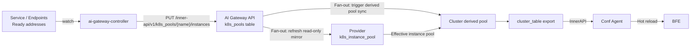

# Chapter 37 ai-gateway-controller Implementation

## Chapter Goals

ai-gateway-controller (formerly Service Controller) is the service discovery component of the Rainway AI Gateway in Kubernetes environments, and the sole writer of K8s pool members. It reports the Ready backend instances of Services/Endpoints, per named port, in full as an instance pool; the Control Plane then fans the pool members out and exports them. This chapter explains the component's process structure, filtering logic, instance extraction, reporting and cleanup semantics, and its links to the Control Plane and the Data Plane.

After reading this chapter, you will be able to:

- Explain the position of ai-gateway-controller and its boundary with AI Gateway API and BFE.
- Describe the directory structure and the main reconcile flow of the controller process.
- Explain the three filtering conditions: namespace, label, and port.
- Master Ready address extraction, `(addr, port)` deduplication, and pool naming rules.
- Understand the roles of full replacement, empty arrays, finalizers, and result write-back.
- Explain deployment arguments, probes, and the upgrade order.

For component responsibilities in the design, see [Chapter 5: Rainway AI Gateway Architecture and Core Concepts](../design/chapter05-system-architecture.md); for installation steps, see [Chapter 18: Installation and Deployment](../operation/chapter18-installation-and-deployment.md).

---

## Component Positioning and Process Structure

ai-gateway-controller lives in the `ai-gateway-controller/` repository. It is a Kubernetes controller built on controller-runtime (Go 1.24, controller-runtime v0.22.4, current version v1.1.0). Its boundary is clear: it watches Services carrying the `ai-gateway-api-name` label together with their same-named Endpoints, and for each named port reports the Ready backend instances in full via the InnerAPI `PUT /inner-api/v1/k8s_pools/{name}/instances` as a "K8s pool".

The controller neither reads nor writes the Control Plane database, and it does not connect to BFE. It writes `k8s_pools` only through the InnerAPI; turning pool members into the Provider mirror and Cluster derived pools, and then exporting them to the Data Plane through `cluster_table`, is entirely done server-side by AI Gateway API.

The process layout is as follows:

| Location | Responsibility |
|----------|----------------|
| `cmd/ai-gateway-controller/main.go` | Entry point: parses arguments and zap logging options, prints the version, calls `controllers.Start` |
| `cmd/ai-gateway-controller/flags.go` | Command-line flag registration and defaults |
| `internal/option/` | Argument validation and global configuration (`SetOptions`) |
| `internal/controllers/start.go` | Assembles the controller-runtime Manager: metrics, health checks, pprof, controller registration |
| `internal/controllers/loadbalancer/service_controller.go` | `ServiceReconciler`: `Reconcile`, `ensureK8sPool`, `deletePool`, finalizer, and the result ConfigMap |
| `internal/controllers/filter/namespace.go`, `label.go` | Namespace and label filtering of Service/Endpoints events |
| `internal/controllers/readiness/ready.go` | Readiness checker for `/readyz` |
| `internal/alb/albProvider.go` | `EnsureK8sPool`, `DeleteK8sPoolByList`, `k8sPoolName`, `getK8sPoolInstances` |
| `internal/alb/innerApiClient.go` | InnerAPI client: `ReplaceK8sPoolInstances`, `DeleteK8sPool`, `GetK8sPool`, `ListK8sPools` |

The controller registers with the reconciler name `service-reconciler` (`setupWithManager`), and the source file name `service_controller.go` keeps the component's former name. The main reconcile flow can be summarized as:

1. Read the Service by `namespace/name`; if the object is already gone and `--skip-nil-svc-delete=true` (the default), return immediately.
2. On first handling, add the finalizer and return, letting the next event continue; if adding fails, retry after 30 seconds.
3. When the object is not deleted, read the same-named Endpoints, report instances for each named port, delete the difference between the new pool name list and the old annotation, and write the annotation back.
4. When the object is deleted, delete the pools recorded in the annotation one by one; remove the finalizer after successful deletion or when `--force-rm-finalizer` is set.
5. Every handling writes a Kubernetes Event and the result ConfigMap; on error with `--retry-interval-unit-sec > 0`, it requeues after that many seconds.

Readiness is driven by the process lifecycle: the Manager is marked Ready when it starts and Unready when it exits, so `/readyz` reflects whether the controller process itself is available.

---

## Service Discovery and Filtering

The controller watches only two resource kinds, Service and Endpoints. The filtering conditions live in `internal/controllers/filter/` and are attached to both kinds through `builder.WithPredicates`.

| Dimension | Argument | Rule |
|-----------|----------|------|
| Namespace | `--namespace` (`-n`) | Comma-separated namespace list; `*` or empty means all namespaces |
| Label | `--ai-gateway-api-name` | The Service's `ai-gateway-api-name` label value must equal this argument; when the argument is `*`, any Service carrying the label matches |
| Port | Service `spec.ports[].name` | The port must have a name; unnamed ports produce no pool |

Filtering happens before events enter the queue: Services/Endpoints outside the namespace list or without a matching label never trigger a reconcile. Endpoints joins the queue as the same-named object (`handler.EnqueueRequestForObject`), so a change to either the Service or the Endpoints lands on the same `service-reconciler`; the reconcile always re-reads the latest Service and Endpoints instead of relying on the event object's content.

This layer also forms the integration contract for application teams: only Services with the correct label and named ports are included in service discovery.

---

## Instance Extraction and Pool Naming

Instance extraction is implemented by `getK8sPoolInstances` in `internal/alb/albProvider.go`, with the following rules:

- Iterate over the Endpoints `Subsets` and find the port matching the port name;
- Read only `subset.Addresses` (Ready addresses) and ignore `notReadyAddresses`;
- Deduplicate by `(addr, port)` to satisfy the Control Plane rule that instances within a pool are unique;
- Fill only `addr` and `port` on the instance object; `weight` is left unset and defaulted to `100` by AI Gateway API.

Each named port corresponds to one pool, and the pool name is generated by `k8sPoolName`:

```
k8s_<namespace>_<service>_<port>[_<cluster>]
```

| namespace | service | port name | cluster | Pool name |
|-----------|---------|-----------|---------|-----------|
| `rainway` | `qwen` | `http` | `szyf` | `k8s_rainway_qwen_http_szyf` |
| `rainway` | `qwen` | `http` | empty | `k8s_rainway_qwen_http` |
| `rainway` | `qwen` | `grpc` | `szyf` | `k8s_rainway_qwen_grpc_szyf` |

When the pool name exceeds 64 characters it is folded into the first 55 characters plus `_` and the first 8 hex digits of a sha256 hash; the hash input is `namespace|service|port|cluster`, so the same port always yields the same pool name. The final name must also pass `validK8sPoolName`: 1-64 characters, only letters, digits, `_`, `-`, and `.`, and no leading or trailing `.`, `-`, or `_`. An invalid name makes the reconcile return an error and retry.

The report body is a bare array of instances, without any wrapper fields:

```json
[
  {"addr": "10.244.1.12", "port": 8000},
  {"addr": "10.244.2.31", "port": 8000}
]
```

The Control Plane parses this array as Instance structures, defaults `weight` to `100`, and validates that `addr` is non-empty, `port` is between 1 and 65535, `weight` is between 0 and 100, and `(addr, port)` is unique within the pool.

---

## InnerAPI Reporting and Cleanup

The InnerAPI endpoints used by the controller are:

| Method | Path | Purpose |
|--------|------|---------|
| `PUT` | `/inner-api/v1/k8s_pools/{name}/instances` | Replace all pool members; create the entry if absent |
| `GET` | `/inner-api/v1/k8s_pools/{name}` | Query the members and last sync time of one pool |
| `GET` | `/inner-api/v1/k8s_pools` | Query summaries of all pools |
| `DELETE` | `/inner-api/v1/k8s_pools/{name}` | Delete a pool |

`PUT` has full-replacement semantics: the request body is the complete set of instances the pool should currently have, and submitting the same snapshot again yields the same result, so the controller can retry freely without producing duplicate members. If a named port has no Ready address, the controller still reports an explicit empty array `[]`, keeping the pool with zero instances — this distinguishes instances being drained from a port being removed.

For authentication, the value of `--ai-gateway-api-token` has the form `Token <identify>`, where `Token ` is the token type prefix and the whole string is used as the `Authorization` header value. The Token must belong to the System Scope and hold write permission on the `k8s_pools` domain; the Support Scope lacks the K8sPool feature and the call returns 402. Tokens are created in the console under "User Management → Token", corresponding to `POST /open-api/v1/auth/tokens`.

Cleanup relies on two records on the Kubernetes side:

- **The `k8s.bfenetworks.com/k8spool-result` annotation**: records the list of pool names currently managed for the Service (a JSON string array). Each reconcile computes the difference between the new list and the old one and deletes pools that are no longer produced after a port rename or removal; pools whose deletion failed stay in the list and are retried in the next round.
- **The `k8s.bfenetworks.com/delete-protection` finalizer**: added when the Service is first handled. When a deletion event arrives, the pools are deleted according to the annotation first, and only after success is the finalizer removed so the Service can really disappear. A `DELETE` returning 404 is treated as success, so repeated cleanup is safe. `--force-rm-finalizer` removes the finalizer even when pool deletion fails, possibly leaving an unreferenced pool behind; use it only after manual confirmation.

The result of each handling is written to two places: the annotation on the Service, and the same-named `<service>.result` ConfigMap. The ConfigMap carries the `bfe-cm-result=yes` and `bfe-result-type=service` labels; `data.result` is `Succ` on success and the error message on failure, and the ConfigMap is deleted when the Service is deleted successfully. This lets operators judge the sync state of a Service without reading controller logs.

---

## Links to the Control Plane and the Data Plane

The controller is responsible only for writing instances into `k8s_pools`. The rest of the path from the pool to the Data Plane is completed inside AI Gateway API and fanned out within a single database transaction:

1. Write or delete the `k8s_pools` row;
2. Find every Provider whose `instance_source=k8s_pool` and `k8s_pool_name` equals this pool name;
3. Refresh each Provider's read-only mirror `k8s_instance_pool` (`PUT` with the new list, `DELETE` with an empty list);
4. Trigger the Cluster derived pool sync of each referencing Provider; the `cluster_table` version is updated automatically by the export signature.

If any step fails, the whole transaction rolls back, so the Provider mirror, the Cluster derived pools, and the pool members always stay consistent. Which pool a Provider references is declared by operators through the OpenAPI `instance_source` and `k8s_pool_name`; the controller never modifies Provider or Cluster configuration.



From a Provider's perspective, "pool absent" and "pool present with zero instances" are the same state: the effective instance pool is empty. In that state the Cluster derived pool is synced to empty, `cluster_table` exports an empty entry, BFE loads the configuration normally, and requests to that Cluster return 500 (`BK_NO_BACKEND`), covered by alerting. This semantics leaves downstream consumers with only one empty state to handle.

---

## Deployment and Operations Essentials

The controller is deployed as a Deployment inside the business Kubernetes cluster, with manifests under `ai-gateway-controller/examples/deploy/`:

- **Workload**: the Deployment is named `bfe-ai-gateway-controller` with `replicas: 1` and the `Recreate` strategy. Pool members are reported in full by a single instance, so one replica prevents multiple writers from overwriting each other.
- **Permissions**: ServiceAccount `bfe-ai-gateway-controller` and a ClusterRoleBinding. The example grants `cluster-admin`; in production it can be narrowed to Services get/patch/list/watch, Endpoints get/list/watch, ConfigMaps create/update/delete/get, and Events create/patch.
- **Arguments**: `--ai-gateway-api-name`, `--ai-gateway-api-addr`, and `--ai-gateway-api-token` must not be empty; `--k8s-cluster-name` must not be empty (the code has a built-in default of `testk8s`, but production should set it explicitly). Other common arguments include `--namespace`, `--retry-interval-unit-sec`, `--force-rm-finalizer`, and `--skip-nil-svc-delete`.
- **Ports and probes**: health checks listen on `:9081`, with liveness and readiness at `/healthz` and `/readyz`; metrics listen on `:9080`; a non-empty `--pprof-address` additionally enables pprof.
- **Security context**: runs as a non-root user with a read-only root filesystem, mounting `emptyDir` volumes at `/tmp` and `/var/run`.

Builds and releases use the repository Makefile: `make build` injects version and commit through ldflags, `make docker` builds the image, and `make docker-push REGISTRY=...` builds `linux/amd64,linux/arm64` images with buildx.

The upgrade order follows the version contract: the InnerAPI `/inner-api/v1/k8s_pools` is available from AI Gateway API v0.0.11, so AI Gateway API (≥ v0.0.11) must be upgraded first, and the controller afterwards; otherwise the controller's reporting requests fail because the server has no such endpoint.

For day-to-day troubleshooting, check in the following order:

| Check | Method |
|-------|--------|
| Is the controller ready? | `GET :9081/readyz`, or the Deployment readiness status |
| Is the Service in discovery? | Confirm the Service carries the `ai-gateway-api-name` label, falls within `--namespace`, and has named ports |
| What was the last result? | Check the Service's `k8s.bfenetworks.com/k8spool-result` annotation and the `<service>.result` ConfigMap |
| Are the pool members correct? | `GET /inner-api/v1/k8s_pools/{name}` for the instance list and `last_sync_time` |
| Is authentication correct? | A 402 on reporting usually means insufficient Token scope or `k8s_pools` domain permission |

---

## Chapter Summary

- ai-gateway-controller is the sole writer of K8s pool members: it watches Services carrying the `ai-gateway-api-name` label and their same-named Endpoints, and reports Ready instances per named port in full via the InnerAPI; it never touches the database or BFE directly.
- Filtering combines three conditions — namespace, label, and port name; instances come from Ready addresses and are deduplicated, and pool names follow `k8s_<namespace>_<service>_<port>[_<cluster>]`, folded into a prefix plus hash when too long.
- `PUT` is an idempotent full replacement, `DELETE` treats 404 as success, and no Ready address yields an empty array; the annotation records pool names for difference-based cleanup, the finalizer ensures pools are deleted before a Service disappears, and results are written to both an Event and the `<service>.result` ConfigMap.
- The fan-out from the pool to the Data Plane is done by AI Gateway API within a single transaction: it refreshes the Provider `k8s_instance_pool` mirror and syncs the Cluster derived pools, which finally reach BFE through the `cluster_table` export. Single-replica deployment and upgrading the API before the controller are prerequisites for stable operation.

---

## References

- `ai-gateway-controller/design-docs/sys-design/overview.md`
- `ai-gateway-controller/design-docs/sys-design/service-discovery-design.md`
- `ai-gateway-controller/design-docs/api-define/service-yaml-api-define.md`
- `ai-gateway-controller/docs/ai-gateway-controller-usage.md`
- `ai-gateway-controller/examples/deploy/`
- `ai-gateway-controller/cmd/ai-gateway-controller/main.go`, `flags.go`
- `ai-gateway-controller/internal/controllers/loadbalancer/service_controller.go`
- `ai-gateway-controller/internal/controllers/filter/namespace.go`, `label.go`
- `ai-gateway-controller/internal/alb/albProvider.go`, `innerApiClient.go`
- `ai-gateway-api/design-docs/api-define/InnerAPI接口定义/k8s-pools.md`