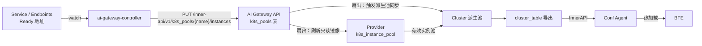

# 第三十七章 ai-gateway-controller实现

## 本章目标

ai-gateway-controller（原名 Service Controller）是壬远 AI 网关在 Kubernetes 环境中的服务发现组件，也是 K8s 实例池成员的唯一写入方。它把 Service/Endpoints 中处于 Ready 状态的后端实例按具名端口全量上报为实例池，再由控制面完成池成员的扇出与导出。本章从实现视角讲解该组件的进程结构、过滤逻辑、实例提取、上报与清理语义，以及它与控制面、数据面的链路。

阅读完本章，你将能够：

- 说明 ai-gateway-controller 的定位及其与 AI Gateway API、BFE 的边界。
- 描述控制器进程的目录结构与 reconcile 主流程。
- 解释命名空间、标签与端口三层过滤条件。
- 掌握 Ready 地址提取、`(addr, port)` 去重与池命名规则。
- 理解全量替换、空数组、finalizer 与结果回写的作用。
- 说明部署参数、探针与升级顺序。

设计中的组件职责见 [第五章 壬远AI网关架构与核心概念](../design/chapter05-system-architecture.md)，安装步骤见 [第十八章 安装部署](../operation/chapter18-installation-and-deployment.md)。

---

## 组件定位与进程结构

ai-gateway-controller 位于仓库 `ai-gateway-controller/`，是一个基于 controller-runtime 的 Kubernetes 控制器（Go 1.24、controller-runtime v0.22.4，当前版本 v1.1.0）。它的职责边界很清晰：监听集群中带 `ai-gateway-api-name` 标签的 Service 及其同名 Endpoints，按每个具名端口把 Ready 后端实例经 InnerAPI `PUT /inner-api/v1/k8s_pools/{name}/instances` 全量上报为「K8s 实例池」。

控制器不直接读写控制面数据库，也不连接 BFE。它只通过 InnerAPI 写入 `k8s_pools`；把池成员变成 Provider 镜像与 Cluster 派生池、再经 `cluster_table` 下发到数据面，全部由 AI Gateway API 在服务端完成。

进程目录结构如下：

| 位置 | 职责 |
|------|------|
| `cmd/ai-gateway-controller/main.go` | 入口：解析参数与 zap 日志选项、打印版本、调用 `controllers.Start` |
| `cmd/ai-gateway-controller/flags.go` | 命令行参数注册与默认值 |
| `internal/option/` | 参数校验与全局配置（`SetOptions`） |
| `internal/controllers/start.go` | 组装 controller-runtime Manager：metrics、健康检查、pprof、注册控制器 |
| `internal/controllers/loadbalancer/service_controller.go` | `ServiceReconciler`：`Reconcile`、`ensureK8sPool`、`deletePool`、finalizer 与结果 ConfigMap |
| `internal/controllers/filter/namespace.go`、`label.go` | Service/Endpoints 事件的命名空间与标签过滤 |
| `internal/controllers/readiness/ready.go` | `/readyz` 的就绪状态检查器 |
| `internal/alb/albProvider.go` | `EnsureK8sPool`、`DeleteK8sPoolByList`、`k8sPoolName`、`getK8sPoolInstances` |
| `internal/alb/innerApiClient.go` | InnerAPI 客户端：`ReplaceK8sPoolInstances`、`DeleteK8sPool`、`GetK8sPool`、`ListK8sPools` |

控制器以 reconciler 名 `service-reconciler` 注册（`setupWithManager`），代码内文件名 `service_controller.go` 保留了组件原名。reconcile 主流程可以概括为：

1. 按 `namespace/name` 读取 Service；若对象已删除且 `--skip-nil-svc-delete=true`（默认），直接返回。
2. 首次处理时先添加 finalizer 并返回，等待下一次事件继续；添加失败则 30 秒后重试。
3. 对象未删除时，读取同名 Endpoints，逐个具名端口上报实例，再将本次池名列表与旧 annotation 做差集删除，最后写回 annotation。
4. 对象已删除时，按 annotation 记录的池名逐个删除；删除成功或设置 `--force-rm-finalizer` 后移除 finalizer。
5. 每次处理都写 Kubernetes Event 与结果 ConfigMap；出错且 `--retry-interval-unit-sec > 0` 时按该秒数 `RequeueAfter`。

就绪状态由进程生命周期驱动：Manager 启动时置为 Ready，退出时置为 Unready，因此 `/readyz` 反映的是控制器进程本身是否可用。

---

## 服务发现与过滤

控制器只监听 Service 与 Endpoints 两类资源，过滤条件在 `internal/controllers/filter/` 中实现，并通过 `builder.WithPredicates` 挂在两类资源上。

| 维度 | 参数 | 规则 |
|------|------|------|
| 命名空间 | `--namespace`（`-n`） | 逗号分隔的命名空间列表；`*` 或空表示全部命名空间 |
| 标签 | `--ai-gateway-api-name` | Service 的 `ai-gateway-api-name` 标签值须与该参数相等；参数为 `*` 时匹配任意带该标签的 Service |
| 端口 | Service `spec.ports[].name` | 端口必须有 name；无名端口不产生池 |

过滤在事件进入队列前完成，未命中命名空间或标签的 Service/Endpoints 不会触发 reconcile。Endpoints 以同名对象加入队列（`handler.EnqueueRequestForObject`），因此 Service 或 Endpoints 任一变化都会落到同一个 `service-reconciler` 上；reconcile 内部总是重新读取最新的 Service 与 Endpoints，不依赖事件对象携带的内容。

这一层过滤同时构成了对应用团队的接入约定：Service 带上正确的标签、端口起好名字，才会被纳入服务发现。

---

## 实例提取与池命名

实例提取由 `internal/alb/albProvider.go` 的 `getK8sPoolInstances` 完成，规则如下：

- 遍历 Endpoints 的各个 `Subsets`，找到与端口名匹配的端口；
- 只读取 `subset.Addresses`（Ready 地址），忽略 `notReadyAddresses`；
- 以 `(addr, port)` 为键去重，满足控制面「同一池内实例不重复」的约束；
- 实例对象只填 `addr` 与 `port`，`weight` 不填写，由 AI Gateway API 侧补缺省值 `100`。

每个具名端口对应一条池，池名由 `k8sPoolName` 生成：

```
k8s_<namespace>_<service>_<port>[_<cluster>]
```

| namespace | service | port name | cluster | 池名 |
|-----------|---------|-----------|---------|------|
| `rainway` | `qwen` | `http` | `szyf` | `k8s_rainway_qwen_http_szyf` |
| `rainway` | `qwen` | `http` | 空 | `k8s_rainway_qwen_http` |
| `rainway` | `qwen` | `grpc` | `szyf` | `k8s_rainway_qwen_grpc_szyf` |

池名超过 64 字符时折叠为前 55 字符加 `_` 与 sha256 前 8 位，哈希输入为 `namespace|service|port|cluster`，因此同一端口始终得到同一池名。最终名称还要通过 `validK8sPoolName` 校验：长度为 1-64 个字符，仅允许字母、数字与 `_`、`-`、`.`，且首尾不得为 `.`、`-`、`_`；不合法时 reconcile 返回错误并进入重试。

上报体是一个实例裸数组，不带任何包装字段：

```json
[
  {"addr": "10.244.1.12", "port": 8000},
  {"addr": "10.244.2.31", "port": 8000}
]
```

控制面按 Instance 结构解析该数组，`weight` 缺省为 `100`，并校验 `addr` 非空、`port` 在 1-65535 之间、`weight` 在 0-100 之间、`(addr, port)` 池内唯一。

---

## InnerAPI 上报与清理

控制器使用的 InnerAPI 端点如下：

| Method | 路径 | 用途 |
|--------|------|------|
| `PUT` | `/inner-api/v1/k8s_pools/{name}/instances` | 全量替换池成员，条目不存在则创建 |
| `GET` | `/inner-api/v1/k8s_pools/{name}` | 查询单个池的成员与最近同步时间 |
| `GET` | `/inner-api/v1/k8s_pools` | 查询全部池摘要 |
| `DELETE` | `/inner-api/v1/k8s_pools/{name}` | 删除池 |

`PUT` 是全量替换语义：请求体即该池当前应有的全部实例，重复提交同一快照结果一致，因此控制器可以任意重试而不产生重复成员。若某个具名端口没有 Ready 地址，控制器仍会上报显式空数组 `[]`，池保留但实例数为零——这使实例被摘除与端口被删除区分开来。

鉴权方面，`--ai-gateway-api-token` 的取值形如 `Token <identify>`，其中 `Token ` 是令牌类型前缀，整体作为 `Authorization` 头的值。该 Token 必须属于 System Scope 并具备 `k8s_pools` 域的写权限；Support Scope 没有 K8sPool Feature，调用会返回 402。Token 在控制台「用户管理 → Token」创建，对应 `POST /open-api/v1/auth/tokens`。

清理逻辑依靠两个 Kubernetes 侧的记录：

- **annotation `k8s.bfenetworks.com/k8spool-result`**：记录该 Service 当前管理的池名列表（JSON 字符串数组）。每次 reconcile 用新列表与旧列表做差集，删除端口改名或移除后不再产生的池；删除失败的池保留在列表中，下一轮继续重试。
- **finalizer `k8s.bfenetworks.com/delete-protection`**：首次处理 Service 时添加，删除事件到达时先按 annotation 删池，成功后再移除 finalizer，Service 才真正消失。`DELETE` 返回 404 视为成功，因此重复清理是安全的。`--force-rm-finalizer` 会在删池失败时也移除 finalizer，可能留下无人引用的池，仅在人工确认后使用。

每次处理的结果写入两处：Service 上的 annotation，以及同名 `<service>.result` ConfigMap。ConfigMap 带 `bfe-cm-result=yes`、`bfe-result-type=service` 标签，`data.result` 成功时为 `Succ`，失败时为错误信息；Service 删除成功时该 ConfigMap 一并删除。这一设计让运维无需查看控制器日志即可判断某个 Service 的同步状态。

---

## 与控制面和数据面的链路

控制器只负责把实例写入 `k8s_pools`。从池到数据面的剩余链路全部在 AI Gateway API 内完成，并在单个数据库事务内扇出：

1. 写入或删除 `k8s_pools` 行；
2. 查出所有 `instance_source=k8s_pool` 且 `k8s_pool_name` 等于该池名的 Provider；
3. 刷新各 Provider 的只读镜像 `k8s_instance_pool`（`PUT` 为新列表，`DELETE` 为空列表）；
4. 逐个触发引用 Provider 的 Cluster 派生池同步，`cluster_table` 版本随导出签名自动更新。

任一步失败整个事务回滚，因此 Provider 镜像、Cluster 派生池与池成员始终一致。Provider 引用哪个池由运维通过 OpenAPI 的 `instance_source` 与 `k8s_pool_name` 声明，控制器不修改 Provider 或 Cluster 配置。



从 Provider 的视角看，「池不存在」与「池存在但零实例」是同一状态：有效实例池为空。此时 Cluster 派生池被同步清空，`cluster_table` 导出空条目，BFE 可以正常加载配置，该 Cluster 的请求返回 500（`BK_NO_BACKEND`），由告警覆盖。这一语义保证了下游消费方只需处理一种空状态。

---

## 部署与运维要点

控制器以 Deployment 形式部署在业务 Kubernetes 集群内，清单位于 `ai-gateway-controller/examples/deploy/`：

- **工作负载**：Deployment 名 `bfe-ai-gateway-controller`，`replicas: 1`，更新策略 `Recreate`。池成员由单实例全量上报，单副本避免多个写入方互相覆盖。
- **权限**：ServiceAccount `bfe-ai-gateway-controller` 与 ClusterRoleBinding。示例授予 `cluster-admin`，生产环境可收敛为 Service get/patch/list/watch、Endpoints get/list/watch、ConfigMap create/update/delete/get、Event create/patch。
- **参数**：`--ai-gateway-api-name`、`--ai-gateway-api-addr`、`--ai-gateway-api-token` 不可为空；`--k8s-cluster-name` 不可为空（代码内置默认值 `testk8s`，生产须显式指定）。其余常用参数包括 `--namespace`、`--retry-interval-unit-sec`、`--force-rm-finalizer`、`--skip-nil-svc-delete`。
- **端口与探针**：健康检查监听 `:9081`，liveness 与 readiness 分别为 `/healthz`、`/readyz`；metrics 监听 `:9080`；`--pprof-address` 非空时额外开启 pprof。
- **安全上下文**：以非 root 用户运行、只读根文件系统，并挂载 `/tmp` 与 `/var/run` 的 `emptyDir`。

构建与发布使用仓库 Makefile：`make build` 通过 ldflags 注入 version 与 commit，`make docker` 构建镜像，`make docker-push REGISTRY=...` 以 buildx 构建 `linux/amd64,linux/arm64` 双架构镜像。

升级顺序与版本契约相关：InnerAPI `/inner-api/v1/k8s_pools` 从 AI Gateway API v0.0.11 起提供，因此必须先升级 AI Gateway API（≥ v0.0.11），再升级控制器；否则控制器的上报请求会因服务端没有对应端点而失败。

日常排障可按以下顺序检查：

| 检查项 | 方法 |
|--------|------|
| 控制器是否就绪 | `GET :9081/readyz`，或查看 Deployment 的 readiness 状态 |
| Service 是否被纳入发现 | 确认 Service 带 `ai-gateway-api-name` 标签、落在 `--namespace` 范围内、端口有 name |
| 最近一次处理结果 | 查看 Service 的 `k8s.bfenetworks.com/k8spool-result` annotation 与 `<service>.result` ConfigMap |
| 池成员是否正确 | `GET /inner-api/v1/k8s_pools/{name}` 查看实例列表与 `last_sync_time` |
| 鉴权是否匹配 | 上报返回 402 通常表示 Token Scope 或 `k8s_pools` 域权限不足 |

---

## 本章小结

- ai-gateway-controller 是 K8s 实例池成员的唯一写入方：监听带 `ai-gateway-api-name` 标签的 Service 与同名 Endpoints，按具名端口把 Ready 实例经 InnerAPI 全量上报，不直接接触数据库或 BFE。
- 过滤由命名空间、标签与端口名三层条件组成；实例取自 Ready 地址并去重，池名按 `k8s_<namespace>_<service>_<port>[_<cluster>]` 生成，超长时折叠为前缀加哈希。
- `PUT` 全量替换幂等、`DELETE` 404 视为成功、无 Ready 地址上报空数组；annotation 记录池名用于差集清理，finalizer 保证 Service 删除前先删池，结果同时写入 Event 与 `<service>.result` ConfigMap。
- 池到数据面的扇出由 AI Gateway API 在单事务内完成：刷新 Provider 的 `k8s_instance_pool` 镜像并同步 Cluster 派生池，最终经 `cluster_table` 导出到 BFE；单副本部署与「先升级 API 再升级控制器」的顺序是稳定运行的前提。

---

## 参考文档

- `ai-gateway-controller/design-docs/sys-design/overview.md`
- `ai-gateway-controller/design-docs/sys-design/service-discovery-design.md`
- `ai-gateway-controller/design-docs/api-define/service-yaml-api-define.md`
- `ai-gateway-controller/docs/ai-gateway-controller-usage.md`
- `ai-gateway-controller/examples/deploy/`
- `ai-gateway-controller/cmd/ai-gateway-controller/main.go`、`flags.go`
- `ai-gateway-controller/internal/controllers/loadbalancer/service_controller.go`
- `ai-gateway-controller/internal/controllers/filter/namespace.go`、`label.go`
- `ai-gateway-controller/internal/alb/albProvider.go`、`innerApiClient.go`
- `ai-gateway-api/design-docs/api-define/InnerAPI接口定义/k8s-pools.md`